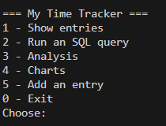
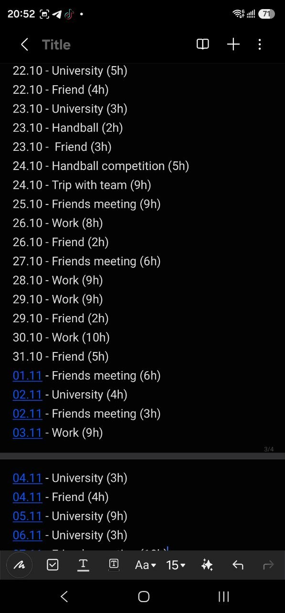
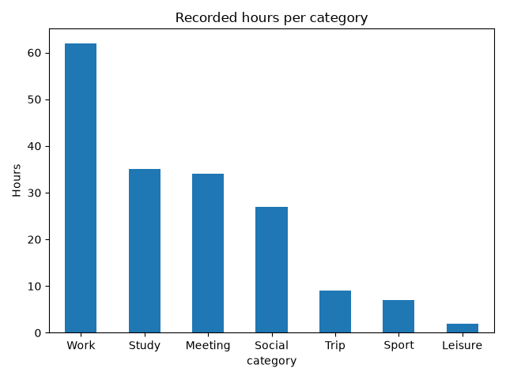
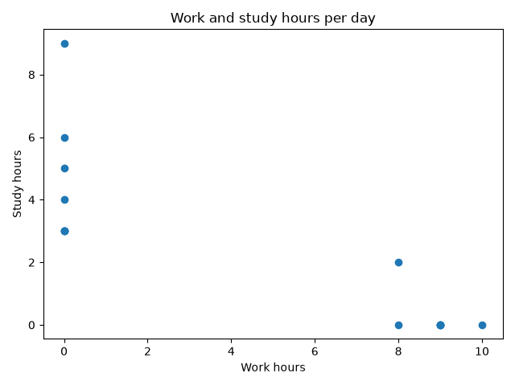

# My Daily Time Spending

Data Centric Programming Assignment 2026 – [Assignment Brief](https://github.com/skooter500/dcp26-assignment/blob/main/dataset_assignment.md)

# Questions

1. Which categories take the largest share of my recorded hours?
2. How different are Work and Study (total hours, length of a typical entry)?
3. Do I work and study on the same days?
4. Does the balance between Work and Study change from week to week?
5. How do weekends differ from weekdays?
6. Which days were the most and the least loaded?

# Data Dictionary

One row = one activity I recorded by hand. A day can have several rows. File: `data/time_spending.csv`.

| Column | Type | Units / format | How I record it |
| --- | --- | --- | --- |
| `date` | Date | YYYY-MM-DD | The day the activity happened |
| `activity` | Text | – | What I did, e.g. Working, University, Talking, Training |
| `category` | Text (categorical) | Work, Study, Social, Meeting, Sport, Trip, Leisure | My grouping of the activity |
| `duration_hours` | Number | Hours (whole numbers so far) | How long the activity took |
| `notes` | Text | – | Short description of the activity |

Rules: one row per activity, recorded on the day it happens. Activities can overlap, so a day can add up to a lot of hours (for example a competition during a trip on 2026-10-24: 14 h).

# Description of the project

A Python program that loads my hand-recorded time log into SQLite, checks the data, analyses it with pandas, draws charts with matplotlib and lets me explore it through a text menu.

- **Dataset:** 33 rows, 20 consecutive days (2026-10-19 to 2026-11-07), 176 hours, 5 columns.
- **Not a full diary:** it covers the main activities, not every hour. A missing Study row means "not recorded", not "did not study".

## Data collection and diary

Every day, I gathered information about what I did that day, but sometimes I forgot to enter the data on a daily basis, so I used this list to make sure I didn't make any mistakes.

# Instructions for use

Menu: 1 show entries (filter), 2 SQL queries, 3 analysis, 4 charts (saved in `charts/`), 5 add an entry, 0 exit. Adding an entry checks the input and writes the row to the CSV and the database; then I commit the CSV.

# How it works:

The CSV is the main file. On every start the database is rebuilt from it, and every row is checked: bad dates, empty fields and durations outside 0–24 are rejected with a reason.

# Findings

| Category | Entries | Hours | Share |
| --- | ---: | ---: | ---: |
| Work | 7 | 62 | 35% |
| Study | 9 | 35 | 20% |
| Meeting | 5 | 34 | 19% |
| Social | 8 | 27 | 15% |
| Trip | 1 | 9 | 5% |
| Sport | 2 | 7 | 4% |
| Leisure | 1 | 2 | 1% |

1. **Work is the biggest category** (62 h, about a third of the total).
2. **Work comes in long blocks** (about 8.9 h per entry), **study in shorter ones** (about 3.9 h).
3. **Work and study almost never share a day:** only 1 of 14 days has both, correlation r = −0.83. This mostly reflects my timetable, not cause and effect.
4. **The weeks differ a lot:** work 17 h, 36 h and 9 h; study 16 h, 0 h and 19 h (the last week has only 6 recorded days).
5. **Weekdays and weekends both average 8.8 h per day**, but weekends contain only Meeting, Social, Sport and Trip.
6. **Busiest day:** 2026-10-24 (14 h). **Quietest:** 2026-11-06 (3 h).

**Limits:** 20 days, 33 rows, whole-hour durations, weekend results rest on 5 days, and the log stops on 2026-11-07.

# List of files in the project

| Files | Source |
| --- | --- |
| data/time_spending.csv | Self recorded, by hand, by me |
| src/db.py, queries.py, analysis.py, charts.py, menu.py | Written by me, with some help from AI, reviewed and run by me |
| charts/*.png | Generated by `src/charts.py` |
| README.md | Improved and added information using AI, edited by me |

The data values are all mine, no AI. I wrote the code myself, with some improvements and minor corrections made using AI.
